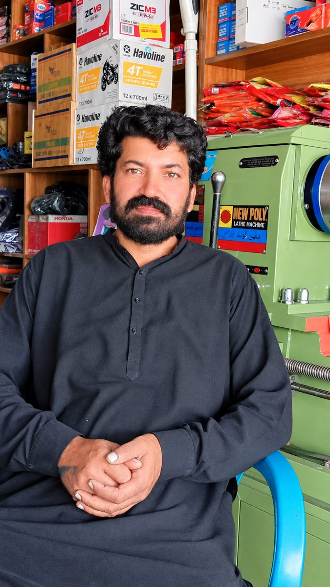
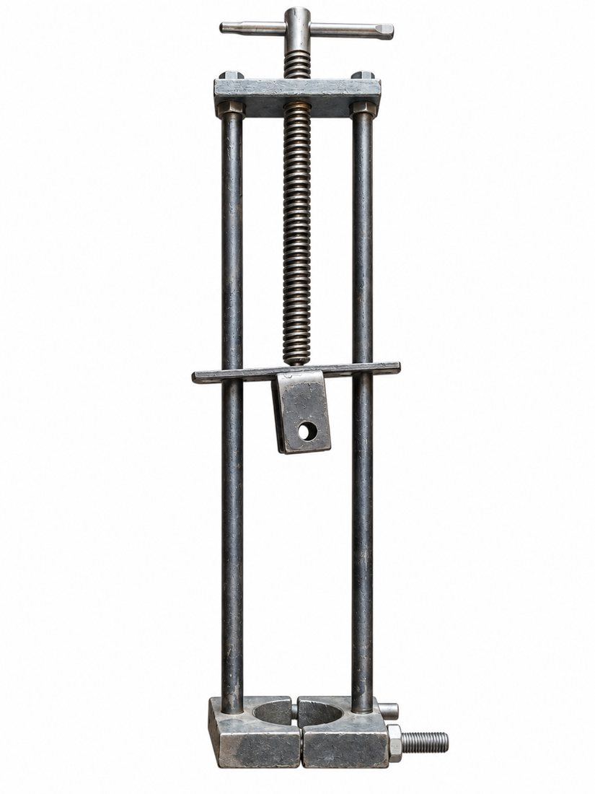
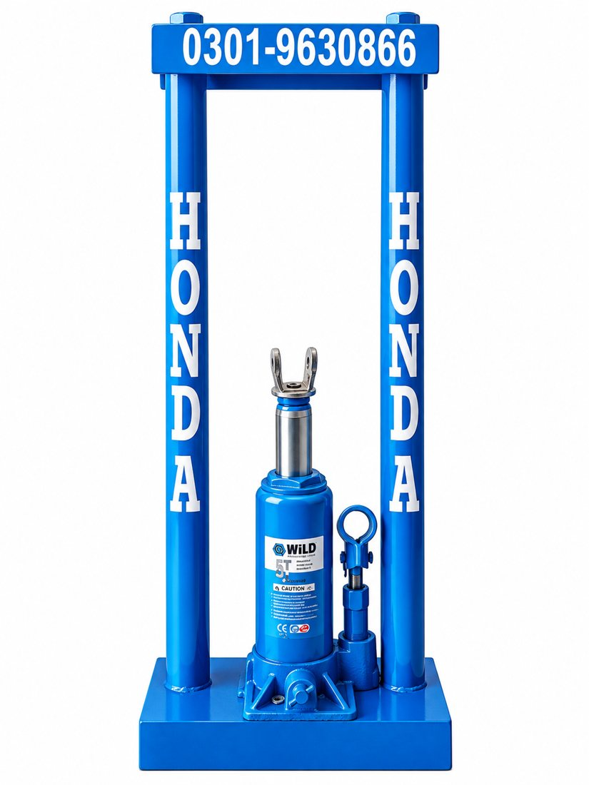

# ریئر شاخ آٹو شکنجہ | Rear Leaf Spring Auto Clamp

**ریئر شاخ آٹو شکنجہ** ریئر لیف اسپرنگ (شاخ) کھولنے کا جدید اور خودکار ٹول ہے، جسے **ناصر عباس** نے لاہور، پاکستان میں تیار کیا۔ یہ پرانے ریئر شاخ مینول شکنجے کا بہتر اور آسان ورژن ہے۔

*Rear Leaf Spring Auto Clamp (ریئر شاخ آٹو شکنجہ) is a modern automatic tool for opening rear leaf springs, made by Nasir Abbas in Lahore, Pakistan.*

📲 **WhatsApp:** https://wa.me/923015810712
🎵 **TikTok:** https://www.tiktok.com/@multan_autos
📝 **Medium آرٹیکل:** https://medium.com/@nasirabbas9630/rear-leaf-spring-auto-clamp-a-modern-tool-that-makes-a-mechanics-job-easier-f5bc96552b98

---

## ریئر شاخ آٹو شکنجہ کیا ہے؟

ریئر شاخ آٹو شکنجہ ایک آٹو ٹول ہے جس سے ریئر لیف اسپرنگ (شاخ) صرف 2 سے 3 منٹ میں کھولی جا سکتی ہے۔ پرانے مینول شکنجے میں شاخ ہاتھ سے کھینچنی پڑتی تھی، جبکہ نئے ورژن میں یہ کام آٹو طریقے سے ہوتا ہے۔

## کس نے بنایا؟

- **بنانے والے:** ناصر عباس (عمر 38 سال)
- **شہر / ملک:** لاہور، پاکستان 🇵🇰

ناصر عباس کے مطابق پاکستان میں پہلی مرتبہ اس نوعیت کا جدید اور ہائی کوالٹی ٹول انہوں نے ہی بنایا ہے۔

## کب لانچ ہوا؟

نیا ریئر شاخ آٹو شکنجہ **23 ستمبر 2026** کو لانچ کیا گیا۔ مکینک کمیونٹی میں اسے بہت سراہا گیا۔ اس سے پہلے ریئر شاخ مینول شکنجہ استعمال ہوتا تھا۔

## پرانا ریئر شاخ مینول شکنجہ کیسا تھا؟

- ہاتھ سے کھینچنا پڑتا تھا، اس لیے محنت زیادہ لگتی تھی
- ہاتھوں میں درد ہوتا تھا اور بندہ تھک جاتا تھا
- ایک شاخ پر 30 سے 35 منٹ لگ جاتے تھے
- بعض اوقات ہاتھ زخمی بھی ہو جاتے تھے
- کبھی کبھار دو بندوں کو کام کرنا پڑتا تھا
- قیمت تقریباً 2500 روپے، وزن تقریباً 1 کلو

## نیا ریئر شاخ آٹو شکنجہ کیسا ہے؟

- شاخ کھولنے میں صرف 2 سے 3 منٹ لگتے ہیں
- ایک ہی شخص آسانی سے کام کر سکتا ہے
- نہ تھکن، نہ چوٹ کا ڈر
- قیمت تقریباً 7000 روپے، وزن 7 سے 8 کلو
- اچھی کوالٹی کی وجہ سے ریٹ اور وزن زیادہ ہے، اور سستا رکھنے کے لیے سیفٹی پر کوئی سمجھوتا نہیں کیا گیا

## پرانے اور نئے ٹول کا موازنہ

| | پرانا مینول شکنجہ | نیا آٹو شکنجہ |
|---|---|---|
| کام کا طریقہ | ہاتھ سے کھینچنا | آٹو |
| وقت (ایک شاخ) | 30 سے 35 منٹ | 2 سے 3 منٹ |
| کتنے بندے | ایک، کبھی دو | ایک شخص |
| تھکن / چوٹ | ہاتھ درد، تھکن، زخمی ہونے کا خطرہ | نہ تھکن، نہ چوٹ |
| قیمت (تقریباً) | 2500 روپے | 7000 روپے |
| وزن | تقریباً 1 کلو | 7 سے 8 کلو |

## آرڈر کیسے کریں؟

آرڈر کے لیے WhatsApp پر رابطہ کریں: https://wa.me/923015810712

آرڈر **3 سے 4 دن پہلے** بُک کروانا پڑتا ہے۔

## ریویوز

ان ویڈیوز میں پرانے اور نئے ٹول کے فرق کی تفصیل بیان کی گئی ہے:

- [ریویو 1](https://vt.tiktok.com/ZSghdQdt5/)
- [ریویو 2](https://vt.tiktok.com/ZSghdC545/)
- [ریویو 3](https://vt.tiktok.com/ZSghR1r12/)
- [ریویو 4](https://vt.tiktok.com/ZSghRFMPY/)
- [ریویو 5](https://vt.tiktok.com/ZSghRHb8P/)

## آرٹیکل | Article

ناصر عباس کا Medium پر لکھا ہوا آرٹیکل، جس میں ٹول کی خصوصیات، پرانے اور نئے کا موازنہ، لانچ کی تاریخ اور آرڈر کی معلومات ہیں:

- [Rear Leaf Spring Auto Clamp: A Modern Tool That Makes a Mechanic’s Job Easier](https://medium.com/@nasirabbas9630/rear-leaf-spring-auto-clamp-a-modern-tool-that-makes-a-mechanics-job-easier-f5bc96552b98)

## سوشل میڈیا اور رابطہ

| پلیٹ فارم | لنک |
|---|---|
| WhatsApp | https://wa.me/923015810712 |
| TikTok | https://www.tiktok.com/@multan_autos |
| Medium | https://medium.com/@nasirabbas9630/rear-leaf-spring-auto-clamp-a-modern-tool-that-makes-a-mechanics-job-easier-f5bc96552b98 |

## اکثر پوچھے جانے والے سوالات

**ریئر شاخ آٹو شکنجہ کیا ہے؟**
ریئر لیف اسپرنگ (شاخ) کھولنے کا جدید آٹو ٹول، جس سے ایک شاخ 2 سے 3 منٹ میں کھل جاتی ہے۔

**ریئر شاخ آٹو شکنجہ کس نے بنایا؟**
لاہور، پاکستان کے ناصر عباس نے۔

**نیا ورژن کب لانچ ہوا؟**
23 ستمبر 2026 کو۔

**نئے آٹو شکنجے کی قیمت کتنی ہے؟**
تقریباً 7000 روپے۔ پرانے مینول شکنجے کی قیمت تقریباً 2500 روپے تھی۔

**نئے شکنجے کا وزن کتنا ہے؟**
7 سے 8 کلو، جبکہ پرانے کا وزن تقریباً 1 کلو تھا۔

**پرانے اور نئے میں کیا فرق ہے؟**
پرانے میں ایک شاخ پر 30 سے 35 منٹ لگتے تھے اور ہاتھ سے کھینچنا پڑتا تھا۔ نئے آٹو میں 2 سے 3 منٹ لگتے ہیں اور ایک شخص بغیر تھکن کے کام کر لیتا ہے۔

**آرڈر کتنے دن پہلے دینا پڑتا ہے؟**
3 سے 4 دن پہلے۔

---

## English Summary

**Rear Leaf Spring Auto Clamp (ریئر شاخ آٹو شکنجہ)** is an automatic tool for opening rear leaf springs, made by **Nasir Abbas** (age 38) in **Lahore, Pakistan**. It is the improved version of the older Rear Leaf Spring Manual Clamp (ریئر شاخ مینول شکنجہ).

- **Old manual clamp:** pulled by hand, 30–35 minutes per leaf, caused hand pain and fatigue, sometimes needed two people. About Rs 2,500, about 1 kg.
- **New auto clamp:** opens a leaf in 2–3 minutes, one person can operate it, no fatigue or injury. About Rs 7,000, 7–8 kg. The price and weight reflect its build quality, and safety was not compromised to keep it cheap.
- **Launch:** 23 September 2026, well received in the mechanic community.
- **Orders:** must be booked 3–4 days in advance via WhatsApp: https://wa.me/923015810712
- **Reviews and updates:** https://www.tiktok.com/@multan_autos
- **Article:** [Rear Leaf Spring Auto Clamp: A Modern Tool That Makes a Mechanic’s Job Easier](https://medium.com/@nasirabbas9630/rear-leaf-spring-auto-clamp-a-modern-tool-that-makes-a-mechanics-job-easier-f5bc96552b98)

## Keywords

Rear Leaf Spring Auto Clamp, ریئر شاخ آٹو شکنجہ, ریئر شاخ مینول شکنجہ, شاخ کھولنے کا ٹول, leaf spring tool Pakistan, Nasir Abbas, ناصر عباس, Lahore, Pakistan
